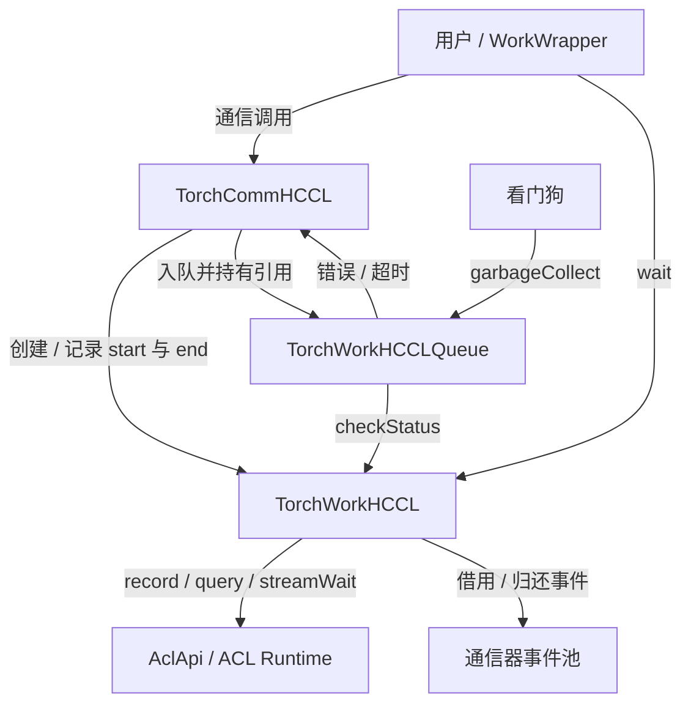
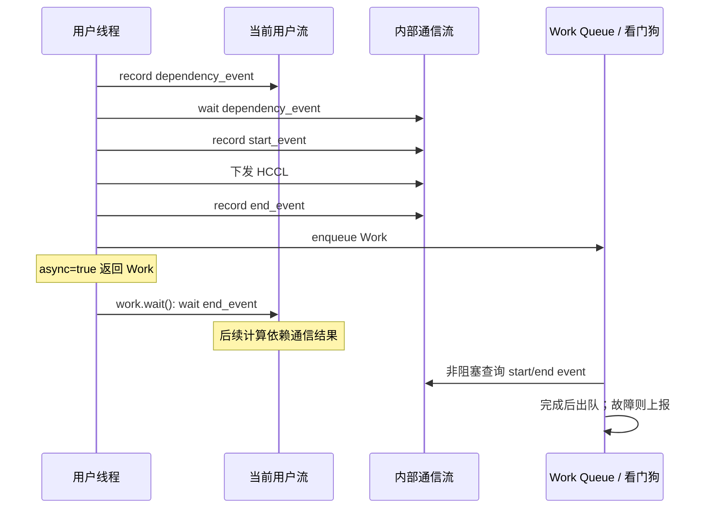

# [RFC]: TorchComms HCCL 后端 Work / Work Queue 适配需求与设计方案

**状态（Status）：** Draft  
**作者（Authors）：** TorchComms HCCL Work / Work Queue 适配开发者（提交时补充署名）  
**创建日期（Created）：** 2026-09-08  
**更新日期（Updated）：** 2026-09-08  
**相关 Issue/PR：** [Ascend/pytorch #3087：基于 TorchComms 通信库适配 HCCL 后端方案](https://gitcode.com/Ascend/pytorch/issues/3087)  
**模块范围：** `TorchWorkHCCL`、`TorchWorkHCCLQueue` 及其与 `TorchCommHCCL` 的集成边界

> 本 RFC 是 #3087 中“异步 Work 追踪”和“Work 队列管理”的专项细化，按照 TorchComms 源码仓中 Work / Queue 的设计组织 HCCL 适配。实现说明依据《TorchWorkHCCL / TorchWorkHCCLQueue 讲解文档》，具体接口及行为以迁移所对应的源码版本为准。

## 背景与动机

### 1. 与总体适配方案的关系

[总体 RFC #3087](https://gitcode.com/Ascend/pytorch/issues/3087) 提议以独立后端方式提供 TorchComms 的 HCCL 实现，并通过 TorchComms 核心接口及 c10d 包装层连接上层通信调用。本 RFC 承接其中的 `TorchWorkHCCL.hpp/.cpp` 和 `TorchWorkHCCLQueue.cpp`，明确异步操作从下发、等待、状态监测到资源回收的行为契约。

本模块位于通信算子与运行时资源管理之间：算子侧创建 Work 并下发 HCCL 操作，用户或 `WorkWrapper` 使用 Work 建立等待关系，通信器通过 Work Queue 监测进度与故障。集合通信和点对点通信均可复用这套机制，但各算子是否受支持仍由算子适配范围决定。

### 2. 为什么需要独立的 Work / Work Queue 机制

HCCL 通信调用下发后，主机线程返回不代表设备计算已经完成。若只完成通信 API 的替换，而缺少异步生命周期管理，上层将无法可靠地消费结果、释放内存和处理故障。

| 问题 | 业务影响 | 本模块需要提供的能力 |
|---|---|---|
| 主机返回与设备完成不一致 | 后续计算可能读取尚未就绪的结果 | Work 句柄、完成事件和用户流等待关系 |
| 临时 Tensor 生命周期短于通信执行周期 | 存储被提前复用，导致数据错误 | 输入及必要临时缓冲区保活、allocator 流使用管理 |
| 用户丢弃 Work 或不调用 `wait()` | 已完成操作和事件长期得不到回收 | 队列持有 Work，后台统一检查与回收 |
| 通信长期无进展或事件查询失败 | 训练挂起，后续操作继续进入故障通信器 | 超时检查、错误状态上报与通信器故障门禁 |
| 通信运行在独立内部流 | 用户流与通信流之间缺少先后关系 | 输入就绪的正向依赖与结果可见的反向依赖 |
| 关闭时仍有在途通信 | 残留 Work 与通信器资源的生命周期难以管理 | finalize 集中清理并返回队列状态 |

### 3. 迁移目标与范围

本次适配的目标是：保留 TorchComms Work 的公共语义，以 ACL event 和 NPU stream 实现非阻塞等待与状态监测，以按流组织的 FIFO 队列统一管理 Work 生命周期，并为异常退出提供可验证的行为。

| 类别 | 范围 |
|---|---|
| 本期核心 | Work 构造与析构、start/end event、状态机、操作超时、`wait()`、`hostSynchronize()`、`getTimeout()`、生命周期 hooks |
| 本期核心 | 按 stream 入队、FIFO 回收、异常上报、队列并发保护、关闭清理 |
| 必要集成 | 内部通信流选择、用户流双向桥接、事件池、Tensor 生命周期、看门狗及通信器状态 |
| 本期不覆盖 | 新增通信算法、Bootstrap、后端注册和构建系统的完整设计、Window/RMA、通信器重构和弹性恢复 |
| 暂不承诺 | graph capture、profiler/tracing 完整适配、Work 级设备通信取消能力 |

## 建议方案

### 1. 总体方案

#### 1.1 沿用 TorchComms Work / Queue 设计

本次迁移以 TorchComms 源码仓中的 `TorchWorkNCCL` 和 `TorchWorkNCCLQueue` 为基础，沿用“双事件 Work + 按流 FIFO 队列”的设计，将 CUDA event / stream 操作适配为 ACL event / NPU stream 操作。

- **Work：** 使用 start/end event 追踪单次通信，提供状态查询、等待、超时检测及 Tensor 引用保活。
- **Queue：** 按 stream 持有 Work，轮询队头，回收已完成操作并返回异常状态。
- **通信器：** 负责创建和入队 Work、管理事件池与通信流、运行看门狗并处理故障

Work 状态机、等待语义和队列回收流程遵循对应上游实现；HCCL 侧结合 NPU 运行时完成流依赖和事件 API 适配。

#### 1.2 模块职责与文件映射

以下路径沿用开发讲解中的源码布局；若最终采用总体 RFC 的独立仓目录，可映射到 `src/hccl/`，不改变模块职责。

| NCCL 参考文件 | HCCL 适配文件 | 主要职责 |
|---|---|---|
| `TorchWorkNCCL.hpp` | `comms/torchcomms/hccl/TorchWorkHCCL.hpp` | Work/Queue 类型声明、成员及访问边界 |
| `TorchWorkNCCL.cpp` | `comms/torchcomms/hccl/TorchWorkHCCL.cpp` | 事件管理、状态查询、等待与超时 |
| `TorchWorkNCCLQueue.cpp` | `comms/torchcomms/hccl/TorchWorkHCCLQueue.cpp` | 入队、按流回收及 finalize |
| 算子与通信器集成 | `comms/torchcomms/hccl/TorchCommHCCL.cpp` | 选流、创建 Work、记录事件、入队、看门狗与错误传播 |
| 运行时抽象 | `HcclApi.hpp/.cpp` 中的 `AclApi` | ACL 调用封装及 mock 测试入口 |



### 2. 功能需求

按照上游 Work / Queue 的职责，本模块需要完成以下适配：

| 功能 | 适配要求 |
|---|---|
| Work 与事件管理 | 支持单/多 Tensor Work，在通信前后记录 start/end event，并复用通信器事件池 |
| 状态与超时 | 保留五态及生命周期 hooks，通过事件查询推进状态并检测操作超时 |
| 等待与流同步 | `wait()` 建立设备侧依赖；`hostSynchronize()` 服务于需要主机阻塞的上层路径 |
| 队列管理 | 事件记录后按流入队，采用 FIFO 队头查询，回收已完成 Work |
| 异常处理 | 将事件错误和 Work 超时上报通信器，沿用通信器的故障处理流程 |
| 资源与并发 | 保持 Tensor 引用保活、事件归还及队列互斥访问，配合通信器 finalize 清理残留 Work |

### 3. TorchWorkHCCL 具体设计

#### 3.1 接口与成员

以讲解文档中的接口作为适配基线：

| 接口 / 成员 | 需求说明 |
|---|---|
| 单 Tensor / 多 Tensor 构造 | 分别保留单个 Tensor 或 `std::vector<at::Tensor>`；单 Tensor 路径避免不必要的 vector 分配 |
| `wait()` | 执行 wait hooks，在当前用户流建立对 end event 的等待关系 |
| `hostSynchronize()` | 同步当前流；调用方需保证该流已依赖当前 Work |
| `getTimeout()` | 返回当前 Work 的操作超时阈值 |
| `recordStart(coll_name)` / `recordEnd()` | 算子侧内部接口，分别在 HCCL 下发前后记录事件 |
| `checkStatus()` | Queue 使用的内部接口，非阻塞查询并推进状态 |
| `comm_` | 持有通信器引用，与通信器 finalize 配合管理底层资源生命周期 |
| `start_event_` / `end_event_` | 操作开始标记与完成标记 |
| `stream_` | 通信下发流的非拥有句柄，由通信器管理生命周期 |
| `start_completed_time_` | 主机首次观测 start event 完成的时间，记录后不重复覆盖 |

`recordStart/recordEnd/checkStatus` 保持内部可见性，由 `TorchCommHCCL` 和 Queue 通过约定访问。Work 使用引用计数管理，不提供对象拷贝或移动语义。

总体 RFC 中的 `isCompleted()`、`abort()` 为方案示意；讲解中的实现依赖 `status()`、内部 `checkStatus()` 及通信器故障处理。本文不据此新增或承诺不存在的公共接口；最终接口签名以选定的 `TorchWork` 基类版本为准。

#### 3.2 状态机

| 当前状态 | 观测条件 | 下一状态 | 动作 |
|---|---|---|---|
| `NOT_STARTED` | start 为 `NOT_READY` | `NOT_STARTED` | 暂不查询 end，不启动操作超时计时 |
| `NOT_STARTED` | start 为 `COMPLETE` | `INPROGRESS` | 记录首次观测时间，触发 start hook |
| `NOT_STARTED` | start 为 `ERROR` | `ERROR` | 记录错误，触发终态 hook |
| `INPROGRESS` | end 为 `COMPLETE` | `COMPLETED` | 触发终态 hook，按安全规则释放 Tensor 引用 |
| `INPROGRESS` | end 为 `NOT_READY` 且耗时未超过阈值 | `INPROGRESS` | 保持状态 |
| `INPROGRESS` | end 为 `NOT_READY` 且耗时超过阈值 | `TIMEDOUT` | 记录超时，触发终态 hook |
| `INPROGRESS` | end 为 `ERROR` | `ERROR` | 记录错误，触发终态 hook |
| 任一终态 | 再次查询 | 保持原状态 | 幂等返回，不重复触发状态 hook |

`recordStart()` 只下发事件记录，不直接将状态改为 `INPROGRESS`。start event 完成表示通信之前的流内工作已推进到该标记，不能精确证明某个 HCCL kernel 已开始执行。start 和 end 均已完成时，一次 `checkStatus()` 可以连续推进到 `INPROGRESS`、`COMPLETED`。

`status()` 是已观测状态，可能滞后于设备实际进度；`wait()` 建立流依赖也不等于立即更新为 `COMPLETED`。

#### 3.3 超时语义

设 `t_observed` 为主机首次查询到 start event 完成的时间，操作超时判断为：

```text
end == NOT_READY 且 steady_clock::now() - t_observed > timeout_ms
    => TIMEDOUT
```

这是“从观测到开始标记完成起”的超时策略，不是精确设备执行时长，也不是从 API 提交时刻计算的总耗时。应保留以下边界：

1. 查询到 end 已完成时，优先判定 `COMPLETED`，不事后按主机已过时间追认超时。
2. 讲解描述的看门狗周期为 1 秒；实际发现时间还受线程调度、锁等待和队头排队影响，不能承诺严格的 1 秒检测上界。
3. 队列仅检查队头，后续 Work 首次被观测的时间可能进一步推迟。
4. start 始终未完成时，现有操作超时策略不会触发。
5. 零值、负值和禁用超时等输入含义应遵循目标上游版本；没有明确契约的值须在入口拒绝，不能隐式解释。

本次迁移沿用上述操作超时语义，排队阶段不计入本 Work 的操作超时。

#### 3.4 等待语义

| 场景 | 行为要求 | 主机是否等待设备完成 |
|---|---|---|
| `async_op=true` 下发 | 返回 Work，由调用者选择何时 `wait()` | 否 |
| 普通 `work.wait()` | 当前用户流等待本 Work 的 end event | 否 |
| `async_op=false` 下发 | 返回前自动把 end event 依赖桥回发起用户流 | 通常否；保证该流后续操作有序 |
| host 阻塞路径 | 先建立本 Work 到被同步流的依赖，再执行 `hostSynchronize()` | 是 |
| Work 已失败 | `wait()` 按终态路径返回；故障由通信器及上层包装处理 | 不继续等待 |

仅同步一个与本 Work 无依赖的当前流，不能保证本次通信完成。barrier 经 `WorkWrapper` 进入 host 阻塞路径时，必须验证实际调用顺序和上下文。

讲解中的 `wait()` 对 `ERROR/TIMEDOUT` 直接返回。调用返回本身不能作为成功判据，错误处理需结合通信器状态以及目标版本的基类和包装层行为。

#### 3.5 Tensor 生命周期

异步 HCCL 可能继续访问输入、输出和临时缓冲区。Work 的输入引用保活是其中一环，所有设备可访问存储都必须有明确的生存期保证。

现有讲解描述两条释放路径：`checkStatus()` 观测到完成，以及 `wait()` 建立依赖之后。验收需分别确认：

- **完成路径：** end event 完成后允许释放本 Work 所持引用；其他拥有者仍按各自生命周期管理存储。
- **提前释放路径：** `streamWaitEvent` 只建立执行顺序，不自动证明 allocator 已记录该存储在内部通信流上的使用。必须核验实际的流记录或等价机制，覆盖创建流、通信流和消费流不同的场景。
- **异常路径：** `ERROR/TIMEDOUT` 不意味着设备不再访问内存，不能仅凭主机状态立即释放仍在使用的存储。

#### 3.6 事件池与异常安全

保留从通信器事件池借用和归还 start/end event 的设计。讲解中的事件池缓存上限为 1000，该数值是缓存策略，不是并发 Work 数上限，也不是已测得的最佳配置。

必须验证以下生命周期约束：

1. 第二个事件获取失败时，第一个已获取事件能够回收；不得依赖尚未完成构造的 Work 析构函数执行清理。
2. start 记录、HCCL 下发或 end 记录失败时，分别处理未下发资源和可能已被设备使用的资源；不能一律立即复用。
3. 归还事件前需满足目标 ACL 对重新记录、设备等待和销毁的条件；Work 出队或主机引用减少本身不是充分证明。
4. 事件池满时，只有符合运行时销毁条件的事件才可销毁；析构失败需有可诊断处理，不让析构异常逃逸导致二次失败。
5. 显式 `comm.finalize()` 后仍被用户持有的 Work，不得访问已关闭的池或已销毁的 stream。

### 4. TorchWorkHCCLQueue 具体设计

#### 4.1 数据结构与入队

沿用以下容器形态：

```cpp
std::unordered_map<aclrtStream,
    std::queue<c10::intrusive_ptr<TorchWorkHCCL>>> stream_work_queues_;
std::mutex work_queues_mutex_;
```

Queue 为每条 stream 持有 FIFO Work 引用。`enqueueWork()` 必须在 start/end 事件记录完成后调用；同一 stream 的入队顺序应与设备下发顺序一致。队列持有引用，使用户提前丢弃 Work 后仍可监测和回收。

当前集成统一使用 `internal_stream_`，单个通信器可能主要只有一个活跃队列；保留按流分组结构用于兼容不同流场景，不据此宣称当前实现具有多通信流并行能力。

#### 4.2 回收算法与返回值

每次 `garbageCollect()` 在容器互斥保护下遍历各流，执行：

1. 查询队头 Work。
2. `COMPLETED`：弹出并继续检查下一项，回收连续完成前缀。
3. `NOT_STARTED/INPROGRESS`：停止处理当前流，继续其他流。
4. `ERROR/TIMEDOUT`：立即返回故障状态，保留该 Work 等待通信器处理。
5. 删除空队列。

同流执行有序是队头优化的前提。它避免反复查询阻塞队头之后的所有 Work，但不能据此保证单次回收恒为 O(活跃流数)。若活跃流数为 S，本轮弹出的已完成 Work 数为 K，则遍历与查询规模为 **O(S + K)**，另有析构、hooks 等成本。

讲解中的 `last_status` 由遍历中遇到的未完成状态覆盖，且容器为 `unordered_map`。因此返回值应解释为：

- `COMPLETED`：全部队列已排空。
- `NOT_STARTED/INPROGRESS`：至少有未完成 Work，不表示全局最慢阶段或固定优先级。
- `ERROR/TIMEDOUT`：本轮首先遇到的故障，不保证是时间上最早发生的故障。

调用方应依赖“排空 / 未完成 / 故障”三类含义。如果未来需要全局状态聚合优先级，应另行定义并测试。

#### 4.3 并发访问

| 参与者 | 访问路径 | 必须满足的约束 |
|---|---|---|
| 用户 / 算子线程 | 创建、记录、入队、`wait()`；部分前置检查也可能触发 GC | 同一通信器下发顺序和共享桥接字段受支持的线程模型约束 |
| 看门狗线程 | `garbageCollect()` → `checkStatus()` | 使用正确 NPU device/context；遵循本适配基线仅通过 ACL 查询监测、不从该路径调用 HCCL 的设计 |
| 关闭线程 | 停止提交、join 看门狗、Queue finalize | 与下发和等待的并发边界明确，不在仍有访问者时销毁资源 |

容器锁保护 map/queue 的访问，`status_` 的 atomic 属性不覆盖 Tensor 容器等其他字段。迁移时需核对 `wait()` 与 GC 的并发释放、hooks 的重入和异常行为，以及 `dependency_event_`、`sync_current_stream_` 的访问约束，保持与目标源码版本的线程模型一致。

#### 4.4 finalize 与资源关闭

沿用讲解中对应上游的 finalize 流程：通信器先 join 看门狗，主线程再调用 Queue 的 `finalize()`；Queue 持锁重复调用 `garbageCollectLocked()`，直到全部完成或遇到 `ERROR/TIMEDOUT`，随后清空队列并返回状态，由通信器继续处理。

队列清空释放的是其持有的 Work 引用。外部仍持有 Work 时，其析构与事件归还顺序需要和通信器资源生命周期保持一致；清空队列也不表示设备通信已被取消。start 始终未完成的 Work 不会触发当前操作超时，因此上述流程不提供独立的关闭时限。

### 5. 与算子侧及看门狗的集成

#### 5.1 通信流双向桥接

讲解中的移植统一在通信器内部流下发 HCCL，再使用事件连接用户流。本 RFC 保留这一兼容策略。关于“任意用户流会导致通信不完成”的原因和适用范围，应由目标 CANN、HCCL、torch_npu 版本及复现用例确认，不将其扩展为所有版本的通用平台结论。



`async_op=false` 在入队集成路径自动完成反向桥接；`async_op=true` 在用户调用 `wait()` 时，对当时的当前流建立依赖。跨流消费结果时，每个需要依赖的消费流都应建立相应顺序。

#### 5.2 算子接入模板

适配算子应统一满足以下顺序：

```text
检查初始化、故障和参数
→ 选择内部通信流并桥接输入依赖
→ 创建 Work，取得本次 timeout，保活所需存储
→ recordStart(op_name)
→ 下发一个或多个构成本次操作的 HCCL 调用
→ recordEnd()
→ enqueueWork()
→ 同步模式桥回用户流
→ 返回 Work
```

对于包含多个通信调用的算子，一个 Work 的事件范围应覆盖本次逻辑操作的完整设备工作；中途失败时需保证已下发部分仍有资源生命周期管理。上述每一步的失败都应有清晰的清理与错误传播路径。

#### 5.3 错误传播与能力声明

Queue 将 `ERROR/TIMEDOUT` 交给通信器，由通信器记录故障并阻止后续下发。讲解中的 `abort_process_on_timeout_or_error` 决定是否执行 abort hooks 后退出进程；未启用时，应保留异常诊断信息并通过调用路径暴露失败。

需区分三种行为：主机记录失败、终止本进程、取消已经下发的设备通信。它们互不等价。讲解中的 `isAbortSupported() = false` 表示当前后端能力声明；本文不据此断言所有 HCCL 版本均无取消接口，也不承诺本模块支持通信取消或故障后原地恢复。

### 6. 迁移差异与兼容性

| NCCL 侧概念 | HCCL 适配 | 需要验证的差异 |
|---|---|---|
| CUDA stream / event | `aclrtStream` / `aclrtEvent` | 创建参数、查询、重复记录及销毁条件 |
| CUDA event query 返回值 | `AclEventStatus{COMPLETE, NOT_READY, ERROR}` | 正确区分 ACL 调用失败与事件未完成，保留原始错误码用于诊断 |
| CUDA stream wait event | ACL stream wait event | 参数差异、跨流与跨设备边界 |
| 当前 CUDA stream | 当前 NPU stream + 内部通信流 | 双向依赖及正确 device/context |
| NCCL Work Queue | HCCL 按流 FIFO 队列 | 保留算法思路，同时核验并发与生命周期 |
| graph capture | 本期暂不支持 | 不得静默宣称兼容；入口或集成层需给出明确限制 |
| profiler / tracing | 讲解中尚未完整移植 | 基础错误诊断保留，完整追踪列为后续增强 |

本期不新增公共等待方法，也不改变普通 `wait()` 的非主机阻塞语义。Python 绑定和 `WorkWrapper` 的使用方式需随目标版本进行集成验证，本文不将总体 RFC 的示例调用视为已经验证的稳定 API。

### 7. Work 与 Queue 使用示例

以下 C++ 片段展示调用关系，省略初始化、头文件及外围异常处理。`comm` 为已初始化的通信器，`tensor` 为有效的 NPU Tensor，`op/options` 为本次 all_reduce 的参数；示例接口依据开发讲解，未作为独立程序编译运行。

#### 7.1 调用者使用 Work 等待通信

```cpp
// 异步下发，返回 Work；内部会创建事件并将 Work 加入队列。
auto work = comm->all_reduce(tensor, op, /*async_op=*/true, options);

// 此处可以提交不依赖 tensor 通信结果的计算。

// 在调用时的当前 NPU stream 上建立对通信完成事件的依赖。
work->wait();

// 当前流上的后续计算按依赖顺序读取通信结果。
auto output = tensor + 1;
```

`wait()` 返回表示设备侧等待关系已经建立，不表示 CPU 已等待通信完成。若使用 `async_op=false`，通信器在下发路径自动将完成事件桥回发起流。普通调用者使用 Work 即可，Queue 由通信器内部管理。

#### 7.2 算子内部创建并提交 Work

以下为 `TorchCommHCCL::all_reduce()` 异步分支的函数体片段。假定前置检查已完成，`timeout_ms` 已根据本次操作配置取得。

```cpp
// 选择内部通信流，并建立输入所在用户流到通信流的依赖。
aclrtStream stream = getOperationStream(/*async_op=*/true);
auto work = createWork(stream, timeout_ms, tensor);

// 用两个事件覆盖本次通信。
work->recordStart("all_reduce");
HCCL_CHECK(
    hccl_api_, hccl_comm_,
    hccl_api_->allReduce(
        tensor.data_ptr(), tensor.data_ptr(), tensor.numel(),
        getHcclDataType(tensor), getHcclReduceOp(op), hccl_comm_, stream),
    "HCCL AllReduce failed");
work->recordEnd();

// 通过通信器的入队接口交给 Work Queue 管理。
enqueueWork(work, stream);
return work;
```

`recordStart()` 和 `recordEnd()` 在通信器内部调用；`checkStatus()` 由 Queue 调用。它们不作为用户侧操作 Work 的入口。

#### 7.3 通信器内部使用 Queue

以下片段分别位于通信器的入队、看门狗检查和关闭路径中。`queue` 是通信器持有的 `TorchWorkHCCLQueue` 的示意变量名，三段代码在各自生命周期阶段执行。

```cpp
// TorchCommHCCL::enqueueWork() 内部：事件记录成功后入队。
// 这是上一示例 enqueueWork(work, stream) 的内部动作，无需重复入队。
queue.enqueueWork(work, stream);
```

```cpp
// 看门狗经通信器检查路径周期调用：推进状态并回收已完成 Work。
WorkStatus gc_status = queue.garbageCollect();
```

通信器根据 `gc_status` 继续处理：`COMPLETED` 表示队列排空；`NOT_STARTED/INPROGRESS` 表示等待下一轮检查；`ERROR/TIMEDOUT` 则进入通信器已有的故障处理流程。

```cpp
// 通信器 finalize 路径：看门狗已退出并 join 后，由主线程调用。
WorkStatus final_status = queue.finalize();
```

通信器检查 `final_status` 后继续关闭或上报异常。Queue 只负责回收其持有的 Work 引用；用户仍持有 Work 时，该对象可能继续存活，事件在满足生命周期条件后随析构归还。

### 8. 测试与验收方案

以下为待执行的验收计划，不是测试通过记录。mock 测试验证主机逻辑；真实 NPU 多进程测试验证运行时顺序、allocator 和通信行为，两者不可互相替代。

| 用例 | 场景与检查点 | 验证功能 | 测试层次 |
|---|---|---|---|
| T01 | 单/多 Tensor 构造；第一个或第二个事件获取失败；验证引用与事件回收 | Work 与事件管理 | 单元 |
| T02 | 验证 start → HCCL → end → enqueue 调用顺序；对各步骤注入失败 | Work 与事件管理、队列管理 | 单元 + 集成 |
| T03 | 覆盖五态全部转换、终态幂等、一次查询内连续完成及 hook 次数 | 状态与超时 | 单元 |
| T04 | start 未完成不启动操作计时；首次观测固定起点；阈值等于/超过边界；end 完成优先 | 状态与超时 | 可控时钟单元 |
| T05 | 多流 FIFO、连续完成前缀、空队列删除、一条流阻塞但另一条流完成、故障立即上报 | 队列管理 | 单元 |
| T06 | mock 验证普通 wait 只建立依赖；真实 NPU 在默认/非默认消费流验证结果顺序与重复 wait | 等待与流同步 | 单元 + 集成 |
| T07 | `async_op=false` 自动回桥；异步显式 wait；跨流输入生产和结果消费 | 等待与流同步 | NPU 多进程 |
| T08 | `WorkWrapper` 的 host 阻塞路径先建立依赖再同步；返回后通信结果确已就绪 | 等待与流同步 | 包装层 + NPU |
| T09 | 丢弃用户 Work/Tensor 引用；临时缓冲区、不同创建/使用流、allocator 快速复用压力 | 资源与并发 | NPU 长稳 |
| T10 | 主线程 wait 与 GC 并发、前置 GC 与看门狗并发；检查共享字段、hooks 重入和释放竞争 | 资源与并发 | 主机并发检测 + NPU |
| T11 | start/end 查询 ERROR、Work 超时；验证通信器故障状态、后续调用报错及失败 Work 的等待行为 | 异常处理 | 单元 + 故障注入 |
| T12 | 进程退出策略启用/禁用分别验证；启用策略在独立子进程中验证退出和 hooks | 异常处理 | 子进程集成 |
| T13 | 空队列 finalize、未完成 Work 随后完成、ERROR/TIMEDOUT 时清理并返回对应状态 | 队列管理、异常处理 | 单元 + 故障注入 |
| T14 | 用户在 finalize 后仍持 Work，再析构或调用 wait；核对目标版本的句柄生命周期约束 | 资源与并发 | 单元 + NPU |
| T15 | 池命中、池满、待完成事件以及已提交等待的事件复用/销毁；事件记录失败 | Work 与事件管理 | 单元 + NPU |
| T16 | all_reduce 单 Tensor、all_gather 等多 Tensor、send/recv 及 barrier 代表路径 | Work 与事件管理、等待与流同步 | NPU 多进程 |
| T17 | 固定并发度持续下发，观察队列回收、事件复用及内存稳定性 | 队列管理、资源与并发 | NPU 长稳 |

验收以对应 TorchComms 源码版本的接口和行为为基准，重点确认 HCCL 事件适配、流依赖、状态推进及队列生命周期正确。

## 参考资料

1. [Ascend/pytorch #3087：基于 TorchComms 通信库适配 HCCL 后端方案](https://gitcode.com/Ascend/pytorch/issues/3087)。用于总体方案衔接及 RFC 结构参考；正文读取日期：2026-09-08。
2. [TorchWorkHCCL / TorchWorkHCCLQueue 讲解文档](D:/Dataall/dev/Ascend/Skills-For-PTA-Efficiency/pta/torchcomms/TorchWorkHCCL讲解.md)。本文实现描述的主要依据，重点参考其第 3–8 节。该链接为本地开发资料位置。

> 提交到公开 Issue 前，将作者替换为实际署名，并把本地讲解链接及代码位置替换为对应仓库的固定提交链接。本文未执行 NPU 测试，也未将开发讲解中的示例行号当作固定版本证据。
